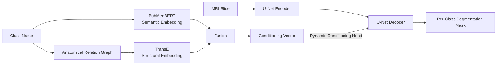
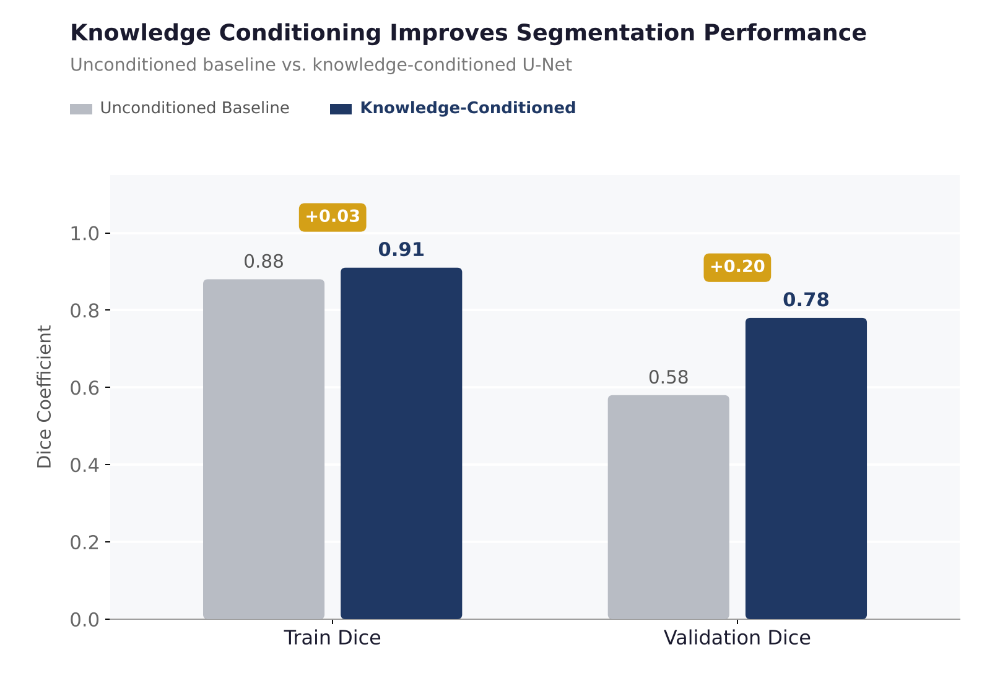
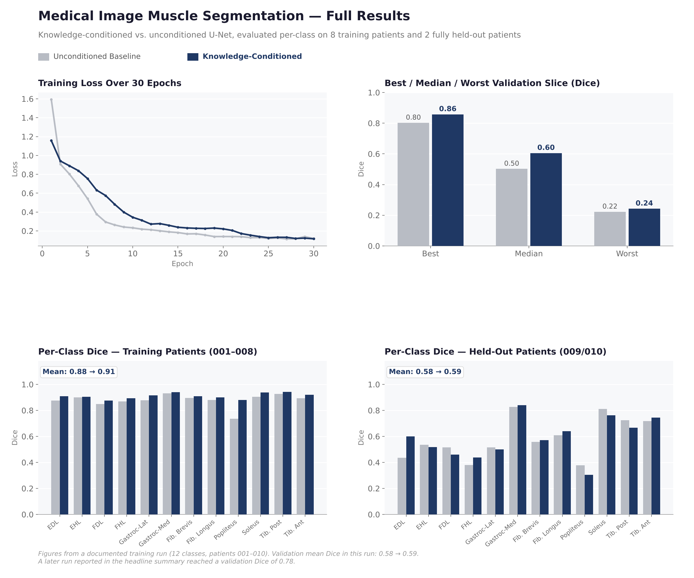

# Knowledge-Conditioned Multimodal Segmentation

A case study in **fusing heterogeneous multimodal representations** into a vision model, and in building the evaluation methodology rigorous enough to tell whether that fusion actually helped — applied here to muscle segmentation on MRI, but the conditioning and evaluation design generalize to other domains.

> ⚠️ No MRI scans, segmentation masks, or patient data are included here — only methodology and aggregate/per-class metrics.
> Full training notebook: https://colab.research.google.com/drive/1VzF1rxOfdthpuQ6Nu9g-0f2I6TJBaHdq?usp=sharing

---

## The Core Idea: Fusing Two Different Kinds of Knowledge

Most conditioning schemes inject a single modality (e.g., just text). Here, two genuinely different representations are fused into one conditioning signal:

- **Semantic** — PubMedBERT embeddings of each class's anatomical description
- **Structural** — TransE embeddings learned from an anatomical relation graph (which muscles belong to which compartments)

The question this architecture is built to answer: **does combining a dense learned representation with an explicit structured one actually improve generalization, or does it just add parameters?** The evaluation design below exists specifically to answer that, not just to report a single accuracy number.

## Evaluation Methodology

The part of this project that matters most for evaluation work:

- **Held-out evaluation, not random split** — the model is tested on patients entirely absent from training, so the result reflects generalization to new subjects, not memorization of training-set variation.
- **Per-class breakdown, not just an aggregate mean** — a single mean Dice can hide a model that's excellent on easy classes and failing on hard ones. Reporting per-class numbers below surfaces that popliteus (a smaller, harder-to-delineate muscle) remains the weakest class even after conditioning — a result an aggregate-only evaluation would have hidden.
- **Bootstrap resampling (1,000 iterations)** for 95% confidence intervals on Dice and IoU, to quantify performance stability across scan quality and patient variation rather than treating a single point estimate as ground truth.
- **A data-quality bug was caught by this evaluation discipline**: an automated cross-patient label-unification pipeline (Hungarian-algorithm-based feature matching) was built to resolve inconsistent raw labels across patients — and during validation, a bug was found where low-confidence matches were silently overwriting already-confirmed labels. Caught before it corrupted the training set.

## Results

  

| Metric | Unconditioned Baseline | Knowledge-Conditioned |
|---|---|---|
| Train Dice | 0.88 | 0.91 |
| **Held-out Validation Dice** | **0.58** | **0.78** |

Full per-class breakdown, training curves, and best/median/worst-case analysis from a documented training run:

  

*(Note: the dashboard above is from an earlier documented run, where held-out validation Dice reached 0.59; the headline table reflects a later run that reached 0.78. Shown separately rather than merged, since they're different runs.)*

## Tech Stack

`PyTorch` · `PubMedBERT` · `TransE` · `Knowledge Graphs` · `U-Net` · `AWS (GPU training)`

## What this maps to

A worked example of multimodal representation fusion in a vision model, paired with an evaluation protocol designed to catch exactly the failure modes — overfitting to training patients, hiding per-class weaknesses behind an aggregate mean, trusting unstable point estimates — that a less careful evaluation would miss.
